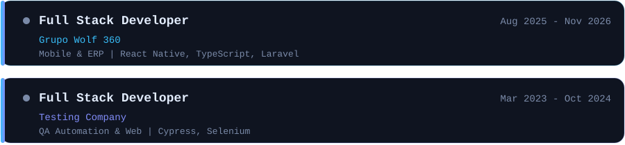

 

 

## `> about`

Software engineer with 2 years of experience building production-grade **Laravel/PHP** applications for ERP and **React Native** mobile apps.
Previously at **Grupo Wolf 360**, where I engineered scalable mobile apps with **React Native & TypeScript**, alongside a comprehensive ERP system built with **PHP/Laravel**.
Studying Computer Science, combining a strong test-driven mindset (Cypress/Selenium) with hands-on experience in LLM integration.

## `> experience`

## `> stack`

<b>Mobile & Front</b> 
  
  
  
  
 
<b>Backend & Data</b> 
  
  
  
  
  
 
<b>Testing & Tools</b> 
  
  
  
 

## `> projects`

  
  
  

## `> github`

  
  

  
  

## `> connect`

  
  
  

