 

 

## 👩‍💻 About

Software engineer with 2 years of experience building production-grade **Laravel/PHP** applications for ERP and **React Native** mobile apps.
I currently work at **Grupo Wolf 360**, engineering scalable mobile apps with **React Native & TypeScript**, alongside a comprehensive ERP system built with **PHP/Laravel**.
Studying Computer Science, combining a strong test-driven mindset (Cypress/Selenium) with hands-on experience in LLM integration.

## 🧑‍💼 Experience

| Position             | Company         | Field                   | Period              |
| -------------------- | --------------- | ----------------------- | ------------------- |
| Full Stack Developer | Grupo Wolf 360  | Mobile & ERP            | Aug 2025 — Present  |
| Full Stack Developer | Testing Company | QA Automation & Web     | Mar 2023 — Oct 2024 |

## 🛠️ Stack

  
  
  
  
  
  
  
  
  
  
  

## 📊 GitHub

  
  

  
  

## 🤝 Connect

  
  
  

